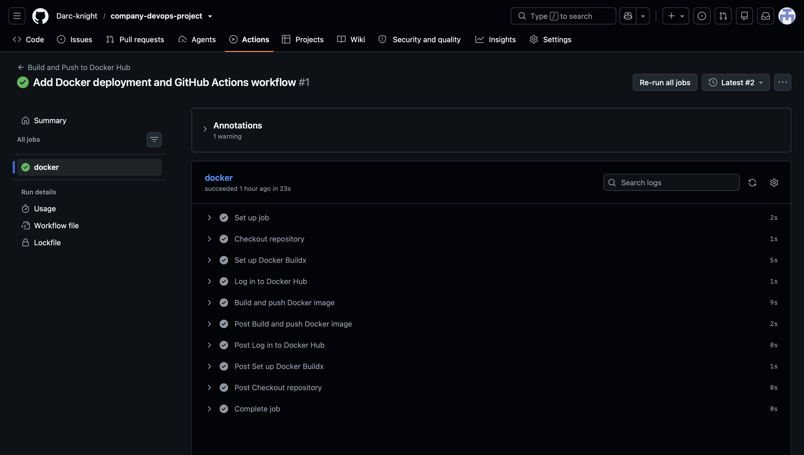
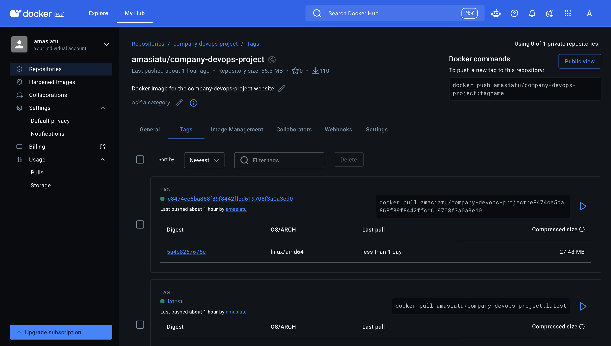
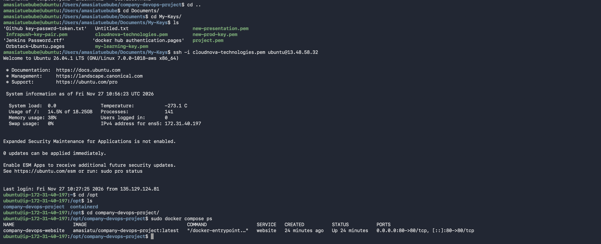
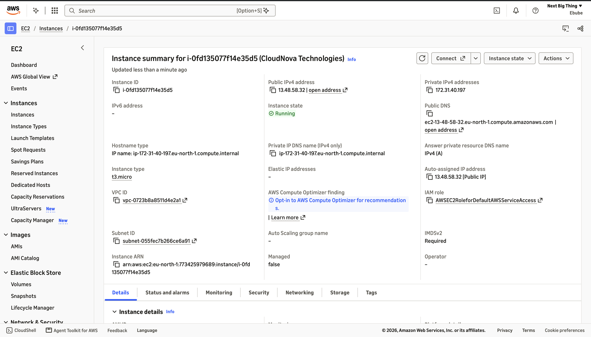
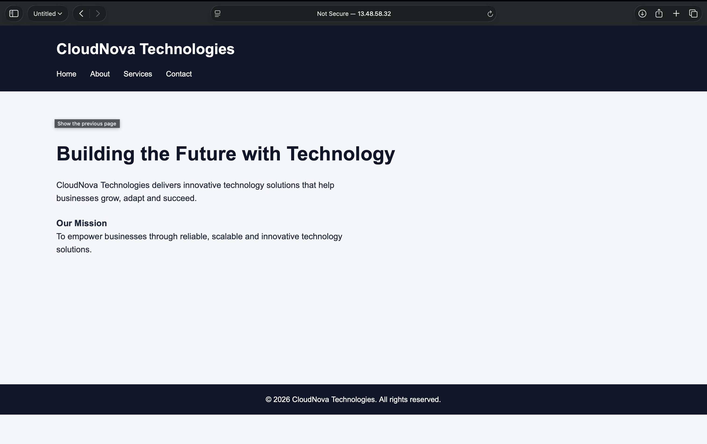

# CloudNova Technologies

## Project Overview

CloudNova Technologies is a fictional technology company website developed as part of a hands-on Cloud and DevOps learning project.

The project demonstrates the development, version control, containerisation, continuous integration and deployment of a multi-page static website using modern DevOps tools and cloud infrastructure.

The application is packaged into a Docker image, automatically built and published to Docker Hub through GitHub Actions, and deployed on an Ubuntu-based AWS EC2 instance.

## Project Objectives

- Build a multi-page company profile website.
- Practice HTML5 and CSS3.
- Manage source code using Git and GitHub.
- Create and manage Docker images and containers.
- Use Docker Compose to manage application deployment.
- Implement CI/CD automation using GitHub Actions.
- Publish Docker images to Docker Hub.
- Deploy the application to AWS EC2.
- Practice Linux server administration and troubleshooting.

## Technologies Used

| Technology | Purpose |
|---|---|
| HTML5 | Website structure |
| CSS3 | Website styling |
| Ubuntu Linux | Development and deployment environment |
| Git | Version control |
| GitHub | Source code hosting |
| Docker | Application containerisation |
| Docker Compose | Container management |
| Nginx | Web server |
| Docker Hub | Docker image registry |
| GitHub Actions | CI/CD automation |
| AWS EC2 | Cloud infrastructure |

## Project Directory Structure

```text
company-devops-project/
│
├── .github/
│   └── workflows/
│       └── docker-build.yml
│
├── .dockerignore
├── Dockerfile
├── compose.yaml
├── index.html
├── about.html
├── services.html
├── contact.html
├── style.css
└── README.md
```

## Website Pages

| Page | Description |
|---|---|
| Home | Introduction to CloudNova Technologies |
| About | Company background, mission and vision |
| Services | Overview of services offered |
| Contact | Company contact information |

## Running the Website Locally

Clone the repository:

```bash
git clone https://github.com/Darc-knight/company-devops-project.git
```

Navigate into the project directory:

```bash
cd company-devops-project
```

Start a local development server:

```bash
python3 -m http.server 8000
```

Open your browser and visit:

http://localhost:8000

Press `CTRL + C` to stop the development server.

## Docker Containerisation

### Dockerfile

The application uses the official lightweight Nginx Alpine image.

```dockerfile
FROM nginx:alpine

COPY . /usr/share/nginx/html

EXPOSE 80
```

### Build the Docker Image

```bash
sudo docker build -t company-devops-project:v1 .
```

### Run the Container

```bash
sudo docker run -d \
  --name company-devops-web \
  -p 8080:80 \
  company-devops-project:v1
```

Access the application:

http://localhost:8080

### Verify the Container

```bash
sudo docker ps
```

## Docker Hub

The Docker image is published to Docker Hub.

**Repository:** `amasiatu/company-devops-project`

The image can be downloaded using:

```bash
sudo docker pull amasiatu/company-devops-project:latest
```

## Docker Compose

Docker Compose is used to define and manage the application deployment through a YAML configuration file.

### Local Compose Configuration

The local configuration uses port mapping `8080:80`.

```yaml
services:
  website:
    image: amasiatu/company-devops-project:v1
    container_name: company-devops-website
    ports:
      - "8080:80"
```

### Start the Application

```bash
sudo docker compose up -d
```

### Check Running Services

```bash
sudo docker compose ps
```

### Stop the Application

```bash
sudo docker compose down
```

## GitHub Actions CI/CD Pipeline

GitHub Actions automates the Docker image build and publishing process.

The workflow is located at:

`.github/workflows/docker-build.yml`

### Workflow Triggers

The pipeline runs automatically when changes are pushed to the `main` branch.

It can also be started manually using `workflow_dispatch`.

### Pipeline Steps

1. Check out the GitHub repository.
2. Set up Docker Buildx.
3. Authenticate with Docker Hub using GitHub repository secrets.
4. Build the Docker image.
5. Publish the image to Docker Hub.

### Docker Hub Image Tags

The workflow publishes two image tags:

- `latest` — identifies the latest published image.
- Git commit SHA — provides a unique identifier for each build.

### GitHub Repository Secrets

The following secrets are configured under:

GitHub Repository → Settings → Secrets and variables → Actions.

```text
DOCKERHUB_USERNAME
DOCKERHUB_TOKEN
```

These credentials allow GitHub Actions to authenticate with Docker Hub without exposing sensitive information in the workflow file.

## AWS EC2 Deployment

The application is deployed on an Ubuntu-based AWS EC2 instance.

### Server Environment

| Component | Configuration |
|---|---|
| Cloud provider | AWS |
| Service | EC2 |
| Operating system | Ubuntu 26.04.1 LTS |
| Container engine | Docker 29.1.3 |
| Compose version | 2.40.3 |
| Deployment directory | `/opt/company-devops-project` |
| Application port | 80 |

### Step 1: Connect to EC2

```bash
ssh -i company-devops-key.pem ubuntu@YOUR_PUBLIC_IP
```

### Step 2: Update Ubuntu

```bash
sudo apt update
sudo apt upgrade -y
```

### Step 3: Install Docker

```bash
sudo apt install docker.io -y
```

Start and enable Docker:

```bash
sudo systemctl start docker
sudo systemctl enable docker
```

### Step 4: Install Docker Compose

```bash
sudo apt install docker-compose-v2 -y
```

Verify:

```bash
sudo docker compose version
```

### Step 5: Create the Deployment Directory

```bash
sudo mkdir -p /opt/company-devops-project
sudo chown ubuntu:ubuntu /opt/company-devops-project
cd /opt/company-devops-project
```

### Step 6: Create the AWS Compose Configuration

Create `compose.yaml`:

```yaml
services:
  website:
    image: amasiatu/company-devops-project:latest
    container_name: company-devops-website
    ports:
      - "80:80"
    restart: unless-stopped
```

### Step 7: Validate the Configuration

```bash
sudo docker compose config
```

### Step 8: Pull the Docker Image

```bash
sudo docker compose pull
```

### Step 9: Deploy the Application

```bash
sudo docker compose up -d
```

### Step 10: Verify Deployment

```bash
sudo docker compose ps
```

The website container should show a running status.

### Step 11: Access the Website

Open a browser and visit:

```text
http://YOUR_EC2_PUBLIC_IP
```

The EC2 security group must allow inbound HTTP traffic on TCP port 80.

## Application Architecture

The deployment follows this process:

```text
Developer
    |
    v
Local Development
    |
    v
Git and GitHub
    |
    v
GitHub Actions
    |
    v
Docker Build and Push
    |
    v
Docker Hub
    |
    v
AWS EC2
    |
    v
Docker Compose
    |
    v
Nginx Container
    |
    v
CloudNova Website
```

## Troubleshooting and Solutions

### 1. Docker Daemon Not Running

**Problem:** Docker commands fail because the Docker daemon is unavailable.

**Possible error:**

```text
Cannot connect to the Docker daemon
```

**Solution:**

Check Docker status:

```bash
sudo systemctl status docker
```

Start Docker if it is stopped:

```bash
sudo systemctl start docker
```

### 2. Port Already Allocated

**Problem:** Another application or container is already using the requested host port.

**Possible error:**

```text
Bind for 0.0.0.0:8080 failed:
port is already allocated
```

**Solution:**

Identify the process using the port:

```bash
sudo ss -tulpn | grep :8080
```

Check running containers:

```bash
sudo docker ps
```

Stop the conflicting container if appropriate, or change the host port mapping.

For example:

```yaml
ports:
  - "8081:80"
```

### 3. Incorrect Docker Hub Image Name

**Problem:** Docker cannot find or access the specified image.

**Possible error:**

```text
pull access denied
repository does not exist
```

**Solution:**

Verify the image reference in `compose.yaml`:

```yaml
image: amasiatu/company-devops-project:latest
```

Then retry:

```bash
sudo docker compose pull
```

If the repository is private, verify Docker Hub authentication and permissions.

### 4. EC2 Security Group Blocking Application Traffic

**Problem:** The Docker container is running, but the website cannot be accessed externally.

**Possible cause:** The EC2 security group does not allow inbound traffic on the application's host port.

**Solution:**

Open:

AWS Console → EC2 → Security Groups → Inbound Rules.

Allow the appropriate TCP port.

For this deployment:

| Type | Port | Source |
|---|---|---|
| HTTP | 80 | 0.0.0.0/0 |

### 5. GitHub Actions Authentication Failure

**Problem:** GitHub Actions cannot authenticate with Docker Hub.

**Possible error:**

```text
unauthorized: incorrect username or password
```

**Solution:**

Verify that the following GitHub repository secrets exist:

```text
DOCKERHUB_USERNAME
DOCKERHUB_TOKEN
```

Check that the username is correct and the Docker Hub personal access token is valid and has write permission.

Never expose access tokens in workflow files or commit them to GitHub.

## Screenshots and Deployment Evidence

Recommended screenshots:

1. CloudNova Technologies website running through the EC2 public IP.
2. Successful GitHub Actions workflow execution.
3. Docker Hub repository showing the published image tags.
4. EC2 terminal showing the running Docker Compose container.
5. AWS EC2 console showing the running instance.

```markdown







 


```

## Project Status

The project has progressed through:

- Multi-page website development.
- Git and GitHub version control.
- Docker image creation.
- Docker Hub image publishing.
- Docker Compose configuration.
- GitHub Actions CI/CD automation.
- AWS EC2 infrastructure setup.
- Docker-based application deployment.

Documentation and troubleshooting are the final project activities.

## Learning Outcomes

This project provided practical experience in:

- Linux server administration.
- Git and GitHub version control.
- Docker image creation and container management.
- Docker Compose deployment.
- CI/CD pipeline implementation.
- Docker Hub image management.
- AWS EC2 provisioning and deployment.
- Basic application and infrastructure troubleshooting.

---

**Repository:** https://github.com/Darc-knight/company-devops-project

**Docker Hub:** https://hub.docker.com/r/amasiatu/company-devops-project
